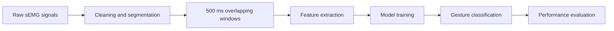

# sEMG Hand Gesture Classification with Deep Learning

A graduation project that explores how surface electromyography (**sEMG**) signals can be transformed into reliable hand-gesture predictions using signal processing, feature engineering, and deep learning.

The academic project reported approximately **97.9% classification accuracy**. The original train/test split is not documented in this public repository, so the result should not be interpreted as accuracy on unseen participants.

This repository currently provides a project overview and a solution file; it does not contain the full training pipeline or a reproducible evaluation.

## Project at a glance

| Area | Details |
|---|---|
| Signal | Surface electromyography (sEMG) |
| Participants | 40 |
| Channels | 4 EMG channels |
| Sampling frequency | 2,000 Hz |
| Recording protocol | 5 repetitions of 6-second recordings |
| Windowing | 500 ms windows with 50% overlap |
| Feature set | 28 time- and frequency-domain features |
| Models explored | CNN, RNN, and Bidirectional LSTM |
| Historical result | ~97.9% reported accuracy; evaluation split not documented |

## The problem

Hand-gesture recognition from sEMG is challenging because biological signals vary between people, recording sessions, and muscle activation patterns. The goal of this project was to build a classification pipeline that could learn meaningful temporal and spectral patterns from multichannel EMG data.

This work connects my main technical interests: **Python, applied AI, signal processing, and human-machine interaction**.

## Pipeline

## Signal processing and feature engineering

Each recording was divided into fixed-duration windows before extracting 28 descriptive features. The feature set included:

- Mean Absolute Value (MAV)
- Root Mean Square (RMS)
- Zero Crossing Rate (ZCR)
- Slope Sign Changes (SSC)
- Mean Frequency (MNF)
- Median Frequency (MDF)
- Spectral Entropy

These features capture signal amplitude, activity changes, and frequency distribution, giving the models a more informative representation than raw values alone.

## Model exploration

The project compared architectures suited to spatial and temporal pattern learning:

- **CNN:** learns local patterns across the feature representation
- **RNN:** models sequential relationships between signal windows
- **Bidirectional LSTM:** uses context from both directions of a sequence

The strongest configuration was reported at approximately **97.9% accuracy** in the academic work. Without the original split and a reproducible evaluation, that number does not establish participant-independent generalization.

## What I learned

- Preparing noisy biological signals for machine-learning workflows
- Designing time- and frequency-domain features
- Structuring multichannel time-series data
- Comparing deep-learning architectures for sequence classification
- Evaluating models beyond the training stage
- Connecting AI software with signals produced by the physical world

## Limitations

The result was obtained on a controlled academic dataset, and the original split is not documented here. Overlapping windows from the same recording can share information, so a new evaluation should split by participant or recording before windowing and keep held-out data separate. Further validation would need unseen participants, different sensor placements and hardware, motion artifacts, and real-time inference measurements.

## Next steps

- Evaluate subject-independent generalization
- Add confusion matrices and per-class metrics
- Compare feature-based learning with end-to-end raw-signal models
- Measure real-time latency on edge hardware
- Prototype live gesture inference from a wearable EMG device

## Author

**Salsabeel Alfayoumi**  
Computer Engineering graduate building Python APIs, data workflows and analytics applications.

[Portfolio](https://salfayoumi.github.io/) · [GitHub profile](https://github.com/salfayoumi)

